<!-- 由 Claude Docs 線上文件匯出（2026-11-21），原文件：https://claude.ai/artifact/DqWxcqYzDFVEsAX91pbV2p 。數學式以 LaTeX 區塊呈現；圖檔在 figures/。以線上文件為準。 -->

# 專題報告：機器學習輔助天線設計——具不確定性估計之神經網路代理模型

## 封面

中原大學

電機工程學系

專題報告

**機器學習輔助天線設計：具不確定性估計之神經網路代理模型**

**——以 WiFi 6E 微帶線耦合饋入平行三槽孔寬頻天線為例**

**Machine-Learning-Assisted Antenna Design: An Uncertainty-Aware Neural-Network Surrogate Model — A Case Study of a Microstrip-Coupled-Fed Triple Parallel-Slot Wideband Antenna for Wi-Fi 6E**

指導教授：【請填寫】 教授

專 題 生：【學號】 楊閔翔

專 題 生：【學號】 【組員姓名】

中 華 民 國 115 年 12 月

## 致謝

本專題能夠順利完成，首先要感謝指導教授【請填寫】教授。在專題進行的過程中，老師從天線的基礎理論、CST 模擬軟體的操作，到研究方向的討論，都給予我們耐心的指導與寶貴的建議，讓我們在遇到困難時能找到解決的方向。

感謝實驗室的學長姊在模擬環境設定與天線量測上的協助，以及組員彼此之間的分工合作。從最初各自保留不同版本的程式，到後來整合成單一專案並以 Git 版本控管追蹤每次修改，這段過程讓我們學到如何有條理地進行一個研究專案。

最後感謝家人一路以來的支持與鼓勵，讓我們能夠專心完成大學階段的學業與本專題。謹以此報告獻給所有幫助過我們的人。

【此段為範本，請依實際情況修改】

## 中文摘要

天線設計通常仰賴全波電磁模擬反覆調整幾何參數，當設計變數增加時，模擬次數會快速膨脹。本專題以一個微帶線耦合饋入之平行三槽孔寬頻天線為對象，建立機器學習代理模型（surrogate model），輸入四個設計參數（W\_slot1、W\_slot2、W\_slot3、Ymax）與頻率，預測 2–8 GHz 的反射係數 S11，用以取代耗時的 CST 模擬並搜尋 WiFi 6E（5.925–7.125 GHz）頻段 S11 < −10 dB 的設計。

訓練資料來自 168 條 CST 模擬曲線，包含四組單參數掃描、兩批各 25 組的拉丁超立方多參數取樣，以及 6 條推薦點與容差角落驗證；各批模擬以自動產生的 CST 巨集執行。模型為五個多層感知器組成的集成，以傅立葉特徵編碼頻率與參數、以物理感知的樣本權重訓練，並以留出驗證在 −10 dB 附近的誤差校正不確定性。最佳化階段在多參數資料涵蓋的信任區域內取樣 5000 組候選，以「覆蓋率優先、再看邊界餘裕」的綜合分數排序，並以類似 UCB 的主動學習推薦下一個模擬點。

在 21 條留出驗證曲線上，模型平均全頻 RMSE 為 1.20 dB，優於內插基準的 1.66 dB；以「覆蓋率誤差 ≤ 5 個百分點、−10 dB 邊緣誤差 ≤ 100 MHz」衡量，21 條中 18 條通過。模型定版後另以 CST 模擬 8 點獨立測試集，通過 6 點，失效的 2 點都是 6E 下緣預測偏樂觀。模型推薦的兩個設計經 CST 實測皆達成 6E 頻段 100% 覆蓋；其中最終設計（W\_slot1 = 36.97、W\_slot2 = 12.502、W\_slot3 = 22.944、Ymax = 13.932 mm）的 −10 dB 頻寬為 5.864–7.856 GHz（相對頻寬約 29%），帶內最差點 −11.91 dB，邊界餘裕由前一版的 0.46 dB 提高到 1.91 dB。製程容差分析顯示，四個尺寸同時偏差 ±0.3 mm 的最差情況經 CST 實測仍為 100% 覆蓋（−11.32 dB），容差上限約為 ±0.5 mm。結果顯示，代理模型配合 CST 驗證迴圈，以 176 次模擬（其中 8 次為獨立測試）完成四參數天線的最佳化；模型適合用來篩選設計，最終設計仍須以模擬器確認。惟本專題的 S11 皆以饋入線的埠阻抗（CST 計算為 100.6 Ω）為參考；改以 50 Ω 正規化後，最終設計在 6E 頻段的覆蓋率降為 0%，接上 50 Ω 系統前需另行匹配，列為本專題的主要限制。

**關鍵詞**：槽孔天線、WiFi 6E、代理模型、機器學習、集成學習、不確定性估計、主動學習、實驗設計

## 英文摘要

Antenna design usually relies on repeated full-wave electromagnetic simulation, and the number of simulations grows quickly as design variables are added. This project builds a machine-learning surrogate model for a microstrip-coupled-fed triple parallel-slot wideband antenna. The model takes four design parameters (W\_slot1, W\_slot2, W\_slot3 and Ymax) and frequency as input and predicts the reflection coefficient S11 from 2 to 8 GHz. It replaces time-consuming CST simulations when searching for designs with S11 below −10 dB across the Wi-Fi 6E band (5.925–7.125 GHz).

The training set contains 168 CST curves: four single-parameter sweeps, two Latin-hypercube batches of 25 multi-parameter samples each, and six verification runs of recommended designs and tolerance corners, all simulated automatically by generated CST macros. The surrogate is an ensemble of five multilayer perceptrons with Fourier-feature encoding and physics-aware sample weights; its uncertainty is calibrated on held-out errors near the −10 dB threshold. The optimizer samples 5,000 candidates inside the region covered by multi-parameter data, ranks them by band coverage first and matching margin second, and recommends the next simulation with a UCB-style active-learning rule.

On 21 held-out curves the surrogate achieves an average RMSE of 1.20 dB, compared with 1.66 dB for an interpolation baseline, and 18 of 21 curves meet the design-level criterion (coverage error ≤ 5 percentage points and −10 dB edge error ≤ 100 MHz). On an independent test set of 8 designs simulated after the model was frozen, 6 of 8 pass; both failures over-predict coverage at the lower edge of the 6E band. Both recommended designs reached 100% coverage of the 6E band when verified in CST. The final design (W\_slot1 = 36.97, W\_slot2 = 12.502, W\_slot3 = 22.944, Ymax = 13.932 mm) has a −10 dB bandwidth of 5.864–7.856 GHz (about 29% fractional bandwidth) and a worst in-band S11 of −11.91 dB, raising the matching margin from 0.46 dB to 1.91 dB. A tolerance analysis shows that the worst case with all four dimensions off by ±0.3 mm still reaches 100% coverage in CST (−11.32 dB), and the tolerance limit is about ±0.5 mm. A surrogate model combined with a CST verification loop optimized the four-parameter antenna with 176 simulations, 8 of them for independent testing; the model is suited to screening designs, and the final design must still be confirmed by the simulator. However, all S11 values are referenced to the port line impedance computed by CST (100.6 Ω); renormalized to 50 Ω, the final design covers 0% of the 6E band, so it needs a matching network before use in a 50 Ω system, which is the main limitation of this work.

**Keywords**: slot antenna, Wi-Fi 6E, surrogate model, machine learning, ensemble learning, uncertainty estimation, active learning, design of experiments

## 目錄

頁碼在匯出 Word 後以自動目錄產生；前置頁（致謝至表目錄）用羅馬數字 I–VI，第一章起用阿拉伯數字。

- 致謝
- 中文摘要
- 英文摘要
- 目錄
- 圖目錄
- 表目錄
- 第一章 緒論
  - 1.1 研究背景
  - 1.2 研究動機
  - 1.3 天線架構與工作原理
  - 1.4 研究目的
  - 1.5 報告架構
- 第二章 研究方法
  - 2.1 研究流程
  - 2.2 天線結構與模擬設定
  - 2.3 資料蒐集與實驗設計
  - 2.4 資料前處理
  - 2.5 代理模型設計與訓練
  - 2.6 不確定性估計與校正
  - 2.7 模型驗證方法
  - 2.8 設計最佳化與主動學習
  - 2.9 軟體實作與版本管理
- 第三章 研究結果與分析
  - 3.1 研究結果
    - 3.1.1 單參數掃描的重建
    - 3.1.2 留出驗證結果
    - 3.1.3 最佳設計的 CST 驗證
    - 3.1.4 製程容差分析
    - 3.1.5 獨立測試集
  - 3.2 結果分析
    - 3.2.1 外推區域的誤差：DOE 第 2 批重訓前測試
    - 3.2.2 搜尋範圍與評分函數的修正
    - 3.2.3 不確定性校正的成效與限制
    - 3.2.4 開發歷程
    - 3.2.5 參考阻抗的限制
- 第四章 結論與未來方向
  - 4.1 結論
  - 4.2 未來方向
- 參考文獻
- 著作權授權書

### 圖目錄

- 圖 1-1 槽孔天線三視圖（最終設計 B）
- 圖 2-1 本專題的模擬—學習—驗證迭代流程
- 圖 2-2 多參數取樣分佈（二維投影）
- 圖 3-1 單參數掃描：CST 原始資料與代理模型預測的 S11 熱圖
- 圖 3-2 留出驗證曲線範例（單參數掃描點）
- 圖 3-3 最終設計 B 的 CST 實測與模型預測比對
- 圖 3-4 設計 A 與設計 B 的 CST 實測 S11
- 圖 3-5 設計 B 的製程容差分析
- 圖 3-6 容差最差角落的 CST 實測 S11
- 圖 3-7 舊模型對 DOE 第 2 批的預測誤差與 Ymax 的關係
- 圖 3-8 修正前的最佳化結果（搜尋範圍未限制）
- 圖 3-9 設計 B 以埠阻抗與以 50 Ω 為參考的 S11

### 表目錄

- 表 2-1 天線固定參數與設計變數
- 表 2-2 訓練資料組成
- 表 2-3 代理模型與訓練設定
- 表 2-4 專案程式檔案與功能
- 表 3-1 留出驗證結果
- 表 3-2 最佳設計 CST 驗證結果
- 表 3-3 容差最差角落的 CST 驗證
- 表 3-4 評分函數修正前後的候選設計
- 表 3-5 專案開發歷程
- 表 3-6 獨立測試集結果
- 表 3-7 設計 B 在兩種參考阻抗下的 S11 表現

## 第一章 緒論

### 1.1 研究背景

無線區域網路（Wi-Fi）已是手機、筆電與物聯網裝置最主要的連線方式。隨著串流影音、雲端服務與多裝置同時連線的需求增加，傳統 2.4 GHz 與 5 GHz 頻段已經相當擁擠。美國聯邦通訊委員會（FCC）於 2020 年開放 5.925–7.125 GHz 作為免執照使用 \[2\]，支援此頻段的 Wi-Fi 6 裝置稱為 Wi-Fi 6E \[12\]，而後續的 Wi-Fi 7（IEEE 802.11be）也同時使用 2.4、5 與 6 GHz 三個頻段。新增的 6 GHz 頻段寬達 1.2 GHz，對天線而言意味著需要在一個相對頻寬約 18% 的範圍內保持良好的阻抗匹配。

天線的阻抗匹配通常以反射係數 S11 衡量，工程上常以 S11 < −10 dB（即輸入功率有 90% 以上進入天線）作為可用頻寬的標準 \[1\]。印刷式槽孔天線結構簡單、易於以印刷電路板製作，且可藉由多個槽孔產生多個共振，是實現寬頻或多頻天線的常見方式。然而槽孔的長度、寬度與位置彼此耦合，改變一個尺寸會同時移動多個共振頻率，設計者難以單靠公式或直覺定出最佳尺寸。

目前天線設計的主流做法，是以 CST Studio Suite 等全波電磁模擬軟體反覆進行參數掃描 \[11\]。每一次模擬需要數分鐘至數十分鐘，當設計變數增加到四個，若每個變數取 10 個值做全網格掃描，就需要 10⁴ = 10,000 次模擬，在專題的時間與運算資源下不可行。代理模型（surrogate model）是解決這個問題的常見策略 \[3\]：先以少量模擬資料訓練一個快速的近似模型，再用它在設計空間中搜尋，只把最有希望的候選送回模擬器驗證。

### 1.2 研究動機

本專題的天線有三個槽孔長度（W\_slot1、W\_slot2、W\_slot3）與饋入線延伸長度（Ymax）可調。專題初期以「一次改一個參數」的方式在 CST 中各掃描約 25 個值，可以看出每個參數如何移動共振頻率，但這種資料在四維參數空間中只是四條線，無法告訴我們「四個參數同時改變」時天線的行為。而單參數掃描中表現最好的組合（W\_slot3 = 22 mm），6E 頻段的覆蓋率只有 80%。

因此我們希望建立一個可以「看過少量模擬後，預測任意參數組合的 S11 曲線」的機器學習模型，並回答三個實際問題：哪一組參數最有可能達到 6E 全頻段匹配？模型對自己的預測有多少把握？下一次 CST 模擬應該跑哪一組參數，才能最有效地改善設計或模型？

另一個動機來自開發方法本身。機器學習模型在訓練資料上幾乎都能擬合得很好，實際的風險在於「模型在沒看過的區域自信地給出錯誤答案」。本專題在過程中實際遇到了這個問題，也因此將「先用新資料測試、再重新訓練」的驗證流程與不確定性校正列為研究重點。

### 1.3 天線架構與工作原理

本專題的天線是微帶線耦合饋入之平行三槽孔寬頻天線（microstrip-coupled-fed triple parallel-slot wideband antenna），三視圖如圖 1-1。饋入線與接地面分別位於基板兩面，是微帶線而非共面波導（CPW）饋入；饋入線不直接接觸槽孔，而是隔著基板以電磁耦合激發槽孔；三個槽孔皆為槽寬遠小於槽長的窄槽（narrow slot）。基板兩面各有一層銅：正面是整片接地面，上面挖出三條水平的矩形槽孔；背面是一條寬 1.5 mm 的微帶饋入線，從基板下緣沿中心線往上延伸，隔著基板通過槽孔下方。

三個槽孔的長度由上而下為 W\_slot1、W\_slot2、W\_slot3，槽寬固定為 L\_slot = 1.5 mm，槽孔中心線彼此相距 10 mm。饋入線的長度由 Ymax 決定：從基板中心（距下緣 25 mm）再往上延伸 Ymax，總長為 25 + Ymax。

**輻射原理。** 微帶線上的電流會在下方接地面感應出反向的回流電流。當接地面上有槽孔橫越這條電流路徑時，回流電流必須繞過槽孔，槽孔兩側因此產生電壓差，在槽內形成電場並向外輻射。依 Babinet 原理，槽孔天線與同尺寸的金屬條帶偶極天線互補，可視為磁偶極 \[1\]。

**多槽孔與頻寬。** 槽孔大約在其長度接近半個導波波長時共振，槽越長，共振頻率越低。三個長度不同的槽孔各自提供共振，若安排得當，相鄰的共振可以合併成一個寬頻帶，這正是覆蓋 1.2 GHz 寬的 6E 頻段所需要的。第三章圖 3-1 的掃描熱圖可以看到，共振頻率隨槽長增加而往低頻移動。

**饋入線長度與匹配。** 饋入線越過槽孔後的部分相當於一段開路殘段（open stub），其長度會改變從饋入點看進去的電抗，用來調整阻抗匹配 \[15\]。Ymax 同時也決定饋入線通過哪些槽孔：Ymax 太小時，饋入線尚未到達上方的槽孔就結束了。因此 Ymax 與三個槽長彼此耦合，這也是單參數掃描難以找到最佳解、需要多參數代理模型的原因。

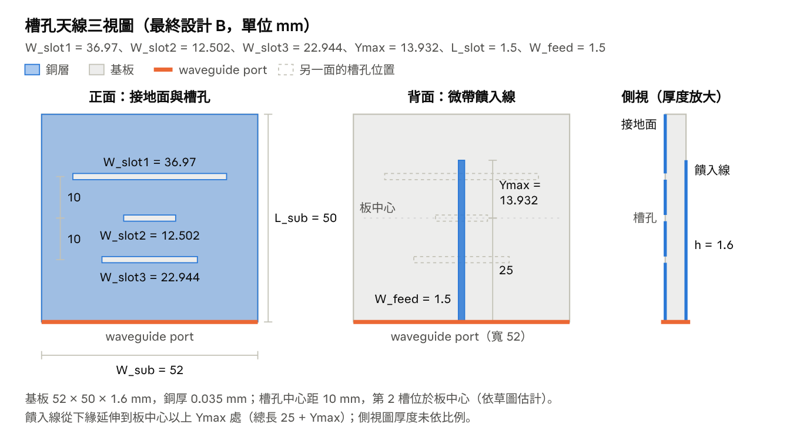

圖 1-1 槽孔天線三視圖，尺寸為最終設計 B（W\_slot1 = 36.97、W\_slot2 = 12.502、W\_slot3 = 22.944、Ymax = 13.932 mm）。

### 1.4 研究目的

本專題的具體目標如下：

1. 建立代理模型，輸入「四個設計參數 + 頻率」，輸出 2–8 GHz 的 S11（dB），並同時輸出預測的不確定性。
2. 以數學化的實驗設計（拉丁超立方取樣）補充多參數資料，並以自動產生的 CST 巨集執行批次模擬。
3. 在模型可信的區域內搜尋 WiFi 6E（5.925–7.125 GHz）頻段 S11 < −10 dB 覆蓋率最高、且邊界餘裕最大的設計。
4. 將模型推薦的設計送回 CST 驗證，形成「模擬 → 學習 → 推薦 → 驗證」的迭代迴圈。
5. 以留出驗證與內插基準（baseline）比較，客觀評估機器學習是否比簡單的內插更有價值，並以模型定版後才模擬的獨立測試集評估模型在設計區的實際準確度。
6. 評估最終設計對製程尺寸誤差的容忍度，並以 CST 驗證最差情況。

### 1.5 報告架構

第二章說明研究流程、天線結構、資料蒐集、代理模型、不確定性校正、驗證方法、最佳化與軟體實作。第三章先呈現模型準確度與最佳設計的 CST 驗證結果，再分析開發過程中發現的外推誤差、評分函數與不確定性問題。第四章總結成果並提出未來方向。

## 第二章 研究方法

### 2.1 研究流程

本專題不是一次訓練就結束，而是模擬、學習與驗證反覆進行的迭代流程（圖 2-1）。每一輪先在 CST 產生資料，訓練代理模型，再用模型搜尋最佳設計與最值得補跑的點；推薦點送回 CST 模擬後，**先用尚未看過它的舊模型比對**，記錄真實誤差，然後才納入訓練資料重新訓練。這個順序很重要：若先重訓再比對，模型已經看過這筆資料，誤差會被低估（例如設計 A 重訓前的 RMSE 為 2.26 dB，重訓後只剩 0.13 dB）。

全部流程共進行了六輪：單參數掃描 → 第一個推薦點驗證（verify\_best）→ DOE 第 1 批 → 設計 A 驗證 → DOE 第 2 批 → 設計 B 驗證；之後再以 CST 驗證設計 B 的製程容差角落，最後將模型定版並以獨立測試集評估，各輪的結果詳見 3.2.4 節。

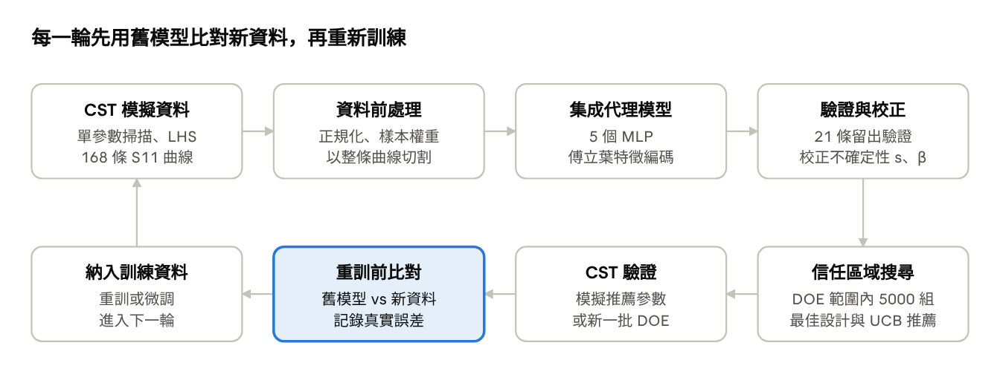

圖 2-1 本專題的模擬—學習—驗證迭代流程。藍色框為本專題最關鍵的步驟：新資料一定先與舊模型比對，才納入訓練。

### 2.2 天線結構與模擬設定

本專題的天線為印刷在介電基板上的槽孔天線，結構如圖 1-1。基板尺寸 52 × 50 mm、厚度 1.6 mm，材料為 CST 材料庫的 FR-4 (lossy)（εr = 4.3、tan δ = 0.025），金屬層（銅）厚度 0.035 mm，饋入線寬 1.5 mm。三個槽孔的長度 W\_slot1、W\_slot2、W\_slot3 與饋入線延伸長度 Ymax 是本專題的設計變數，其餘尺寸固定（表 2-1）。模擬使用 CST Studio Suite，頻率範圍 2–8 GHz，每條 S11 曲線 1001 個頻點（間距 6 MHz）。

**表 2-1 天線固定參數與設計變數**

| 參數 | 說明 | 數值 (mm) | 類型 |
| --- | --- | --- | --- |
| W\_sub | 基板寬度 | 52 | 固定 |
| L\_sub | 基板長度 | 50 | 固定 |
| H\_sub | 基板厚度 | 1.6 | 固定 |
| H\_cu | 銅箔厚度 | 0.035 | 固定 |
| W\_feed | 饋入線寬度 | 1.5 | 固定 |
| L\_slot | 槽孔寬度（槽寬） | 1.5 | 固定 |
| W\_slot1 | 第 1 槽孔長度 | 20–45（掃描） | 設計變數 |
| W\_slot2 | 第 2 槽孔長度 | 5–29（掃描） | 設計變數 |
| W\_slot3 | 第 3 槽孔長度 | 5–29（掃描） | 設計變數 |
| Ymax | 饋入線延伸長度 | 0–18.5（掃描） | 設計變數 |

**激發埠設定。** 饋入線在基板下緣以 CST 的波導埠（waveguide port）激發。波導埠先在埠截面上求解傳輸線的二維模態（微帶線為準 TEM 模），再以該模態激發三維結構，因此 S11 是相對於饋入線本身的特性阻抗計算。本專題的求解器未勾選 Normalize to fixed impedance，所有 S11 皆以埠模態阻抗為參考。CST 計算的埠線阻抗為 100.6 Ω（5 GHz），因此本報告所有 S11 都是對約 100 Ω 的參考阻抗而言；改以 50 Ω 正規化的結果見 3.2.5 節。依微帶線公式 \[15\] 估算，此線寬在 FR-4、h = 1.6 mm 上的特性阻抗約為 74 Ω（50 Ω 約需線寬 3 mm），與 CST 的 100.6 Ω 差距明顯，原因尚未釐清，可能與波導埠的設定有關。埠截面必須大到能容納微帶線周圍的邊緣電場，否則場會被埠邊界截斷而造成埠阻抗誤差。但埠也不宜過大，以免埠內出現高階模態。

CST 內建的 Calculate port extension coefficient 巨集依線寬 w、板厚 h 與介電常數 εr 計算擴展係數 k，建議埠在左、右與上方各延伸 k × h，下方則只延伸到接地面；k 一般在 5–10 之間，取決於 w/h、εr 與最高模擬頻率 \[16\]。以本天線 w = 1.5 mm、h = 1.6 mm、εr = 4.3、頻率 2–8 GHz 執行此巨集，得 k = 7.35（整個頻率範圍內 k 介於 4.21–7.35，取最大值，使線阻抗誤差小於 1%），建議埠寬 w + 2kh ≈ 25.0 mm、饋入線上方高度 kh ≈ 11.8 mm。

本專題的波導埠寬度取整個基板下緣 52 mm，高度【請填寫】mm。此寬度足以容納邊緣場，但大於上述建議值，其合理性以下列三項檢查確認：（1）埠模態的二維電場集中在饋入線下方，並在埠邊界前衰減；（2）埠阻抗接近饋入線的特性阻抗；（3）另以巨集計算的 k 值建立較小的埠，兩者的 S11 差異很小，表示埠尺寸不影響結果。【待補：以 k = 7.35 建立的埠與目前埠的 S11 比較結果】

### 2.3 資料蒐集與實驗設計

訓練資料來自三種來源（表 2-2）。

**單參數掃描。** 每次只改變一個參數，其餘固定，共四個掃描檔各 25 組。掃描後發現 Ymax 在 12–18.5 之間沒有資料，另補掃 13 組。這類資料能清楚顯示單一參數對共振頻率的影響，但在四維空間中只是幾條線，且固定值彼此不同（例如 W\_slot1 掃描時 W\_slot3 = 8，而 W\_slot3 掃描時 W\_slot1 = 44）。

**多參數實驗設計（DOE）。** 為了讓模型學到參數之間的交互作用，本專題以拉丁超立方取樣（Latin Hypercube Sampling, LHS）\[6\] 在最佳區域附近同時改變四個參數。LHS 將每個參數的範圍切成 n 等份，每一份恰好取一個樣本，確保每個參數都被均勻涵蓋。程式會產生 2000 組候選 LHS 設計，取「樣本間最小距離最大」的一組（maximin），讓點與點之間盡量分散。第 1 批以當時的最佳點（W\_slot1 = 44、W\_slot2 = 14、W\_slot3 = 22、Ymax = 18.5）為中心；第 2 批則因模型建議的最佳區域已移出第 1 批範圍，將 W\_slot1 延伸到 36、Ymax 延伸到 11，並與第 1 批在 W\_slot1 = 40–42 重疊以便銜接。兩批的分佈如圖 2-2。

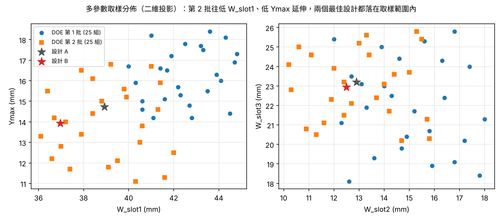

圖 2-2 多參數取樣分佈（二維投影）：圓點為 DOE 第 1 批，方塊為第 2 批，星號為經 CST 驗證的兩個最佳設計

**推薦點驗證。** 每次模型產生最佳設計後，將該組參數送回 CST 模擬，存成 verify\_best、verify\_best2、verify\_best3，各 1 條。

**表 2-2 訓練資料組成**

| 資料檔 | 類型 | 組數 | 變動參數與範圍 (mm) | 最佳 6E 覆蓋率 |
| --- | --- | --- | --- | --- |
| Wslot1(20\_50) | 單參數掃描 | 25 | W\_slot1 20–45 | 0% |
| Wslot2(5\_30) | 單參數掃描 | 25 | W\_slot2 5–29 | 21.5% |
| Wslot3(5\_30) | 單參數掃描 | 25 | W\_slot3 5–29 | 80.0% |
| Ymax(0\_25) | 單參數掃描 | 25 | Ymax 0–12 | 18.0% |
| Ymax(12.5\_18) | 單參數補掃 | 13 | Ymax 12.5–18.5 | 0% |
| doe\_batch1 | LHS 第 1 批 | 25 | W\_slot1 40–45、W\_slot2 12–18、W\_slot3 18–26、Ymax 14–18.5 | 91.5% |
| doe\_batch2 | LHS 第 2 批 | 25 | W\_slot1 36–42、W\_slot2 10–16、W\_slot3 20–26、Ymax 11–17 | 97.0% |
| verify\_best | 推薦點驗證 | 1 | 43.5 / 15.8 / 20.3 / 16.4 | 65.5% |
| verify\_best2（設計 A） | 推薦點驗證 | 1 | 38.92 / 12.9 / 23.196 / 14.725 | 100% |
| verify\_best3（設計 B） | 推薦點驗證 | 1 | 36.97 / 12.502 / 22.944 / 13.932 | 100% |
| verify\_tol03 | 容差角落驗證（±0.3 mm） | 1 | 37.27 / 12.202 / 23.244 / 14.232 | 100% |
| verify\_tol05 | 容差角落驗證（±0.5 mm） | 2 | 36.47 / 13.002 / 22.444 / 13.432；37.47 / 12.002 / 22.444 / 14.432 | 98.5%、100% |

單參數掃描在交會點有 1 組重複，去重後共 168 條曲線、約 16.8 萬個頻點。另有一個舊天線的掃描檔 W4(0\_13) 參數名稱不同，預設排除。參數範圍依檔案實際內容列出；檔名上的範圍（例如 20\_50）是原本計畫的掃描範圍，與實際完成的不同。

verify\_tol03 與 verify\_tol05 是設計 B 的容差角落驗證（3.1.4 節），在模型定版前已納入訓練。另有 8 條獨立測試曲線（3.1.5 節）存放在訓練程式不會讀取的資料夾，不參與訓練與不確定性校正。

**自動化模擬。** cst/make\_doe.py 以 --batch N 指定批次，各批的範圍與亂數種子寫在程式中，重產結果不變；程式輸出參數清單（CSV）與 CST VBA 巨集。巨集在 CST 內逐組設定參數、重建模型、執行求解器，並把 S11 以與參數掃描匯出相同的格式附加到輸出檔。每跑完一組就寫入，中途中斷可以從第 N 組接著跑；巨集也會先重設所有固定參數，避免沿用上一次留下的值。另以 --test 產生獨立測試集的參數與巨集，輸出到訓練資料夾以外，確保測試資料不會被誤用於訓練。

### 2.4 資料前處理

CST 匯出檔的每組模擬以 `#Parameters = {...}` 開頭，接著是頻率與 S11 兩欄。解析程式會讀出全部參數，自動找出「在資料中有變動」的參數作為模型輸入，並進行以下處理：

1. **資料檢查**：各檔的參數名稱必須一致，否則停止並列出檔名；交會點重複的模擬只保留一份；無法轉成數字的行與空的模擬組跳過。
2. **特徵縮放**：設計參數與頻率以 min-max 縮放到 \[0, 1\]；S11 以 z-score 標準化；分母加上極小值防止除以零。正規化參數只用訓練集計算。
3. **以整條曲線為單位切割**：驗證時整條曲線藏起來，而不是隨機抽頻點。若隨機抽頻點，同一條曲線的相鄰點會同時出現在訓練與驗證集，造成資料洩漏，驗證誤差會被嚴重低估。
4. **樣本權重**：依天線設計的重點給不同頻點不同權重——目標頻段內 ×2；S11 在 −14 至 −6 dB 之間（接近 −10 dB 邊界，決定頻寬）×1.5；S11 < −25 dB 的深谷 ×0.4。深谷在設計上意義不大（−25 dB 與 −40 dB 都已經匹配良好），但數值變化很劇烈，若不降權，模型會把容量花在追深谷而忽略頻寬邊界。權重最後除以平均值，使平均權重為 1。

### 2.5 代理模型設計與訓練

代理模型的任務是監督式迴歸：輸入正規化的四個設計參數 p 與頻率 f，輸出該頻點的 S11。模型每次預測一個頻點，要得到整條曲線就把 1001 個頻點一次批次輸入。

**傅立葉特徵編碼。** S11 曲線在共振附近會出現尖銳的谷，而一般全連接網路傾向學到平滑的函數（頻譜偏差）。本專題參考 Tancik 等人的做法 \[4\]，先把輸入展開成不同頻率的正弦與餘弦：

```latex
\gamma(f) = [\, f,\ \sin(k\pi f),\ \cos(k\pi f)\,],\quad k = 1,\dots,48
```

每個設計參數也以相同方式展開 3 組（k = 1, 2, 3）。四個參數時，輸入維度為 1 + 2 × 48 + 4 × (1 + 2 × 3) = 125。頻率用較多的展開項，是因為共振谷在頻率軸上很窄；參數方向的變化較平滑，展開太多反而容易在樣本之間產生振盪。

**網路架構。** 編碼後的特徵送入 4 層、每層 192 個神經元的多層感知器（MLP），激活函數為 SiLU \[13\]，最後一層輸出一個值（標準化的 S11）。

**損失函數與優化。** 損失為加權均方誤差：

```latex
L = \frac{1}{N}\sum_{i=1}^{N} w_i\,(\hat{y}_i - y_i)^2
```

其中 wᵢ 為 2.4 節的樣本權重。優化器為 AdamW \[8\]（學習率 2 × 10⁻³、weight decay 10⁻⁴），學習率以餘弦曲線衰減至 10⁻⁵ \[9\]，batch size 4096。訓練長度依資料量自動決定，使每個模型約更新 1 萬次；目前 16.8 萬個頻點對應 238 個 epoch。模型以 PyTorch \[10\] 實作，有 GPU 時自動使用 CUDA。

**集成。** 以不同亂數種子（42、142、242、342、442）訓練 5 個相同架構的模型，取平均作為預測、標準差作為不確定性的基礎 \[5\]。

**表 2-3 代理模型與訓練設定**

| 項目 | 設定 |
| --- | --- |
| 任務 | 監督式迴歸：\[W\_slot1, W\_slot2, W\_slot3, Ymax, f\] → S11 (dB) |
| 輸入編碼 | 頻率 48 組、參數各 3 組 sin/cos 傅立葉特徵，共 125 維 |
| 網路 | MLP，4 層 × 192 神經元，SiLU |
| 損失函數 | 加權 MSE（頻段 ×2、邊界 ×1.5、深谷 ×0.4） |
| 優化器 | AdamW，lr 2e-3，weight decay 1e-4 |
| 學習率排程 | Cosine annealing，最低 1e-5 |
| Batch size | 4096 |
| 訓練長度 | 每個模型約 1 萬步（目前 238 epochs） |
| 集成數 | 5 |
| 微調（iterative\_train.py） | lr 5e-5，預設 300 epochs |

**迭代微調。** 補跑少量 CST 資料後，可用 iterative\_train.py 在既有模型上以較低學習率微調，不必從頭訓練。實測若用 2 × 10⁻⁴，已收斂模型的訓練 RMSE 會從約 0.02 dB 升至約 0.04 dB，因此預設為 5 × 10⁻⁵。當參數範圍改變時（例如加入新一批 DOE），則重新執行主程式完整訓練。

### 2.6 不確定性估計與校正

集成成員只差在亂數種子，彼此太相似，標準差通常偏小。專題初期第一個通過驗證的設計，模型自報不確定性只有 ±0.30 dB，實際全頻 RMSE 卻是 2.26 dB。因此本專題以留出驗證的結果校正不確定性 \[14\]：

```latex
\sigma = \sqrt{(s\,\sigma_{ens})^2 + (\beta\,d)^2}
```

其中 σ\_ens 為集成標準差，d 為該組參數離最近一筆訓練樣本的正規化歐氏距離。s 是整體放大倍數（限 1–10），β 代表「離資料越遠、誤差越大」的額外加寬。兩者在留出驗證時，以驗證曲線的實際誤差做高斯負對數概似的網格搜尋：

```latex
\min_{s,\beta}\ \sum_{j}\left[\ln \sigma_j^2 + \frac{e_j^2}{\sigma_j^2}\right]
```

eⱼ² 為第 j 條驗證曲線在 −10 dB 附近的均方誤差，σ\_ens 亦取同一組頻點：只用 6E 頻段 ±0.2 GHz 內、實測或預測 S11 落在 −14 至 −6 dB 的頻點，這類頻點不足 5 個的驗證曲線不參與。不確定性在設計上的用途是判斷 S11 是否越過 −10 dB；若以全頻誤差校正，共振谷深度的誤差（常達 10 dB）會把 σ 撐大。s 與 β 連同訓練樣本位置存在模型檔中，之後所有預測自動套用。

### 2.7 模型驗證方法

本專題以四層驗證評估模型：

1. **留出驗證（hold-out）**：藏起 21 條曲線不訓練——五個單參數掃描檔各藏中間 1 條（W\_slot1 = 32、W\_slot2 = 17、W\_slot3 = 18、Ymax = 6、Ymax = 15.5）；每批 DOE 依 W\_slot1 排序後平均藏 5 組；少於 3 條的檔（verify\_best、verify\_best2、verify\_best3、verify\_tol03、verify\_tol05）整檔藏起。用其餘 147 條訓練後，計算每條驗證曲線的全頻 RMSE 與設計用途準確度。
2. **內插基準（baseline）**：為了確認機器學習的價值，每個驗證點都與「不用機器學習」的做法比較：驗證點在掃描線上時，用相鄰兩條曲線線性內插；沒有掃描線可用（DOE 點）則取參數空間最近 4 條曲線做距離反比加權平均。
3. **重訓前測試**：每批新的 CST 資料在納入訓練之前，先用 compare\_verify.py 與舊模型比對，等於一次性的獨立測試集。比對項目包括 6E 覆蓋率、帶內平均 S11、−10 dB 邊界頻率、共振頻率與深度、全頻與帶內 RMSE，以及不確定性校準度（實際誤差 ÷ 自報 σ、落在 ±2σ 內的頻點比例）。結果附加到 outputs/verify\_log.csv，並記錄模型存檔時間；若模型比驗證檔新（可能已用它訓練過），程式會發出警告。
4. **獨立測試集**：模型定版後，在最終設計周圍另取 8 點以 CST 模擬（cst/make\_doe.py --test），結果存放在訓練程式不會讀取的資料夾，不參與訓練、校正或任何設定的調整，只用來評估定版模型一次。這是本專題唯一完全獨立的準確度評估。

**設計用途準確度。** 天線設計只關心 S11 是否低於 −10 dB，而整條曲線的 RMSE 常被共振谷深度拉高（例如實測 −37.6 dB、預測 −27.5 dB），卻不影響設計判斷。因此本專題以兩個與設計直接相關的量判斷模型是否「夠準」：6E 頻段覆蓋率誤差 ≤ 5 個百分點，且 −10 dB 區段上下緣的頻率誤差 ≤ 100 MHz，兩者都滿足才算通過。邊緣先限制在頻段 ±0.2 GHz 內再比較，因為離頻段更遠的邊緣不影響覆蓋率。獨立測試集的通過率另以 Clopper-Pearson 方法 \[17\] 計算 95% 信賴區間。

### 2.8 設計最佳化與主動學習

**評估指標。** 對每條（預測或實測的）S11 曲線計算下列指標：覆蓋率（帶內 S11 < −10 dB 的頻點比例）、最差子頻段覆蓋率（用於 WiFi 7 三頻段，避免寬的 6E 頻段稀釋窄的 2.4 GHz 頻段）、邊界餘裕（帶內最差點比 −10 dB 低多少，限 0–5 dB），以及封頂平均 S11（每點最深只算到 −20 dB）。

**綜合分數。** 候選設計以下式排序：

```latex
Score = 70\,C + 30\,C_{min} + M - 0.2\,\bar{S}_{cap}
```

C 與 C\_min 為覆蓋率與最差子頻段覆蓋率（0–1），M 為邊界餘裕（dB），S̄\_cap 為封頂平均 S11（dB，為負值，因此減去後變成加分）。覆蓋率佔 0–100 分；邊界餘裕只有覆蓋率 100% 時才可能大於 0，用來在多個 100% 的設計中挑出最不怕製程誤差的；深度項約 2–4 分，只當最後的決勝依據。這個式子是經過修正的版本，修正原因見 3.2.2 節。

**搜尋方式。** 一個參數時以步長 0.05 細掃，二至三個參數時用網格，四個以上則在「信任區域」內取樣 5000 組：以每筆多參數資料（DOE 與 verify，共 56 組）為中心，在正規化空間半徑 0.15 的球內均勻取樣，並限制在這些資料的參數範圍內（W\_slot1 36.1–44.8、W\_slot2 10.2–18、W\_slot3 18.1–25.8、Ymax 11.1–18.4）。球形取樣使同時改變多個參數時，總偏移量仍受限制。代理模型預測 5000 條曲線只需數秒，而同樣數量的 CST 模擬則需數天以上。

**主動學習。** 除了分數最高的設計，程式也推薦「分數 + 15 × 不確定性」最高的點作為下一次 CST 模擬。這是類似貝氏最佳化中信賴上界（UCB）\[7\] 的準則：同時考慮「可能很好」與「模型不確定」，補跑這種點最能改善模型。

### 2.9 軟體實作與版本管理

專案以 Python 實作，依賴 PyTorch 2.14、NumPy 2.5 與 Matplotlib 3.11（版本記錄於 requirements.txt），程式檔案與功能如表 2-4。專案以 Git 管理並同步至 GitHub（SeanXD000/ANTENNA-ML）；模擬資料、輸出圖與模型權重不進版控。每次 commit 後在 README 的變更紀錄記下修改內容與當時的驗證數字，另以「架構與目標.md」對照標準機器學習開發流程，記錄每一步的做法與完成狀態。專案整合前，組員各自保留的多個版本（V1、V2、兩版迭代訓練程式）先完整備份，再保留功能最完整的 V2 作為主程式，並修正其中說明與實作不符之處。

**表 2-4 專案程式檔案與功能**

| 檔案 | 功能 |
| --- | --- |
| antenna\_ml.py | 主程式：讀取 CST 匯出檔 → 集成訓練 → 留出驗證與不確定性校正 → 搜尋最佳設計 → 主動學習推薦；可以 --band 指定 2G4 / 5G / 6E / WIFI7 |
| compare\_verify.py | CST 驗證結果與模型預測自動比對，輸出比對圖與紀錄；判定設計用途準確度，多組時計算通過率與信賴區間 |
| iterative\_train.py | 在既有模型上以新資料微調 |
| cst/make\_doe.py | 產生第 N 批 LHS 參數清單與 CST 巨集；--test 產生獨立測試集 |
| cst/run\_doe\*.bas | CST VBA 巨集，自動逐組模擬並匯出 S11 |
| train.py | 入門範例：最小的 PyTorch 代理模型 |
| tolerance.py | 製程容差分析：以 CST 實測設計為名目點做 Monte Carlo，估計良率與單一參數敏感度 |
| cst/run\_verify\_tol\*.bas | CST 巨集，模擬容差最差角落 |

## 第三章 研究結果與分析

本章的核心結果是：代理模型在 21 條留出曲線上平均誤差 1.20 dB，優於內插基準的 1.66 dB，在模型定版後才模擬的 8 點獨立測試集上設計用途通過 6 點；模型推薦的最終設計經 CST 驗證達成 6E 頻段 100% 覆蓋、邊界餘裕 1.91 dB。3.1 節呈現這些結果，3.2 節分析開發過程中發現的問題與修正。

### 3.1 研究結果

#### 3.1.1 單參數掃描的重建

圖 3-1 將每個單參數掃描檔畫成熱圖：橫軸為頻率、縱軸為掃描的參數、顏色為 S11，左欄為 CST 原始資料，右欄為代理模型在同一組固定參數下的預測。亮色的斜線就是共振頻率隨參數移動的軌跡。模型重建了各掃描中主要共振的位置與移動方向，例如 W\_slot3 從 18 增加到 29 mm 時，6E 頻段內的共振從約 7.2 GHz 往低頻移到約 6 GHz；W\_slot2 增加時，4–6 GHz 之間的共振往低頻移動。這表示模型學到的是與物理一致的變化趨勢，而不只是記住個別曲線。圖中只列單參數掃描檔：DOE 檔的四個參數同時改變，無法畫成單一參數的熱圖，準確度改以 3.1.2 節的留出驗證評估。

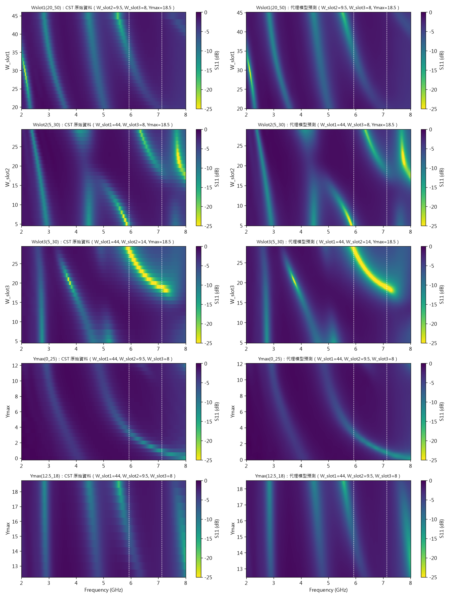

圖 3-1 單參數掃描：CST 原始資料（左）與代理模型預測（右）的 S11 熱圖（五個單參數掃描檔，定版模型），白色虛線為 6E 頻段邊界

#### 3.1.2 留出驗證結果

以 147 條曲線訓練、藏起 21 條驗證的結果如表 3-1（定版模型）。整體平均 RMSE 為 1.20 dB，內插基準為 1.66 dB，21 條中 19 條優於基準。

**表 3-1 留出驗證結果（168 條資料，21 條留出）**

| 驗證組 | 點數 | 代理模型全頻 RMSE (dB) | 設計用途通過 |
| --- | --- | --- | --- |
| 單參數掃描（各檔中間 1 條） | 5 | 0.05–0.49 | 5/5 |
| DOE 第 1 批 | 5 | 0.36–2.24（平均 1.35） | 5/5 |
| DOE 第 2 批 | 5 | 0.53–2.94（平均 1.89） | 3/5 |
| verify\_best | 1 | 0.64 | 1/1 |
| verify\_best2（設計 A） | 1 | 0.97 | 0/1 |
| verify\_best3（設計 B） | 1 | 1.79 | 1/1 |
| 容差角落（verify\_tol03、verify\_tol05） | 3 | 1.00–1.96 | 3/3 |
| **全部** | **21** | **平均 1.20（內插基準 1.66）** | **18/21** |

兩種資料的誤差差了約一個數量級。單參數掃描上的驗證點兩側都有非常接近的訓練曲線，是「內插」，誤差只有 0.05–0.49 dB（圖 3-2）；DOE 點四個參數同時不同，周圍的訓練樣本較疏，誤差升至 0.4–2.9 dB。真正決定設計品質的是後者，因此本專題後續都以 DOE 區域的誤差作為模型好壞的主要依據。

以設計用途準確度（2.7 節）衡量，21 條中 18 條通過，平均覆蓋率誤差 3.2 個百分點、平均 −10 dB 邊緣誤差 50 MHz。未通過的 3 條中，2 條是 DOE 第 2 批高 W\_slot2（約 15.7）、低 Ymax（≤ 12.8）的角落，覆蓋率誤差為 +10.5 與 −26.5 個百分點，是多參數資料最稀疏的區域；另 1 條是設計 A，預測 88.5%、實測 100%，屬於保守方向的錯誤。設計 B 與三個容差角落全部通過。這也顯示整條曲線的 RMSE 與設計用途不一致：設計 B 的 RMSE 為 1.79 dB，比多數通過的 DOE 點都大，但它的覆蓋率與頻寬邊緣都預測正確。

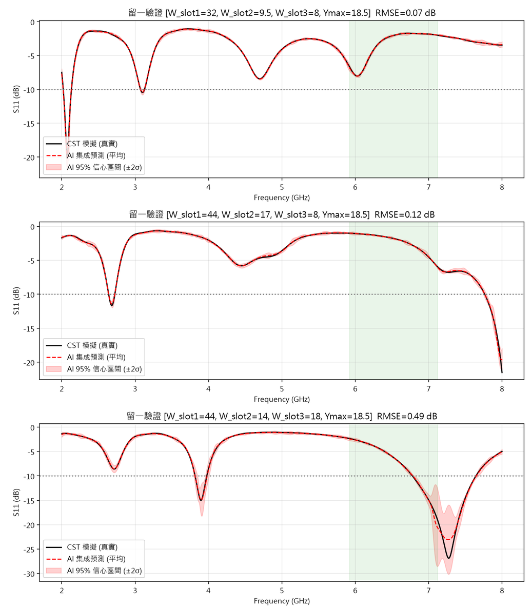

圖 3-2 留出驗證曲線範例（單參數掃描點）：黑線為 CST，紅虛線為集成預測，紅色帶為 ±2σ

#### 3.1.3 最佳設計的 CST 驗證

本專題共有三個模型推薦點送回 CST 驗證。第一個（verify\_best，\[43.5, 15.8, 20.3, 16.4\]）是只用單參數掃描訓練的模型所推薦，當時模型自報不確定性高達 ±3.7 dB，實測 6E 覆蓋率只有 65.5%。這個失敗反映了單參數資料的不足，也是加入 DOE 的直接原因。加入 DOE 後的兩個推薦點（設計 A、B）實測皆達到 100%，結果如表 3-2。

**表 3-2 最佳設計 CST 驗證結果（預測皆為重訓前的模型）**

| 項目 | 設計 A 預測 | 設計 A 實測 | 設計 B 預測 | 設計 B 實測 |
| --- | --- | --- | --- | --- |
| W\_slot1 / W\_slot2 / W\_slot3 / Ymax (mm) | 38.92 / 12.9 / 23.196 / 14.725 | （同左） | 36.97 / 12.502 / 22.944 / 13.932 | （同左） |
| 6E 覆蓋率 | 100% | 100% | 100% | 100% |
| 帶內平均 S11 (dB) | −16.58 | −16.01 | −15.57 | −17.02 |
| 帶內最差點 (dB) | — | −10.46 | −12.05 | −11.91 |
| 邊界餘裕 (dB) | — | 0.46 | 2.05 | 1.91 |
| −10 dB 頻寬 (GHz) | 5.768–7.172 | 5.786–7.724 | 5.810–7.778 | 5.864–7.856 |
| 主共振頻率 (GHz) | 6.482 | 6.524 | 6.662 | 6.698 |
| 主共振深度 (dB) | −56 | −38.2 | −23.0 | −27.8 |
| 全頻 RMSE (dB) | — | 2.26 | — | 1.20 |
| 模型自報 σ (dB) | ±0.30 | — | ±0.52 | — |

設計 B 的 −10 dB 頻寬為 5.864–7.856 GHz（寬 1.99 GHz、相對頻寬約 29%），完整涵蓋 6E 頻段，低頻端與高頻端各留有 61 MHz 與 731 MHz 的餘裕。與設計 A 相比，設計 B 的主共振較淺，但在約 6.04 GHz 多了一個共振（約 −21 dB），把設計 A 在 6.0 GHz 附近只有 −10.5 dB 的弱點拉低（圖 3-4）。對實際製作而言，這 1.45 dB 的額外餘裕比主共振深度更重要：設計 A 只要製程或基板介電常數稍有偏差，最差點就可能超過 −10 dB。

模型對設計 B 的預測也明顯比設計 A 準確：全頻 RMSE 從 2.26 dB 降到 1.20 dB，共振頻率誤差 36 MHz，邊界餘裕預測 2.05 dB、實測 1.91 dB。主要誤差仍在共振谷底（圖 3-3）：模型沒有畫出 6.04 GHz 的窄共振，把它平滑成約 −14 dB 的平台，主共振也預測得較淺。主共振深度的誤差發生在 S11 遠低於 −10 dB 的位置，不影響覆蓋率，這是樣本權重對深谷降權的預期結果；但 6.04 GHz 的共振被平滑成約 −14 dB，正好落在 −10 dB 附近，使設計 B 在 −10 dB 附近頻點的 RMSE 達 2.92 dB。這個誤差的方向是保守的（實測比預測好），所以覆蓋率判斷仍然正確。

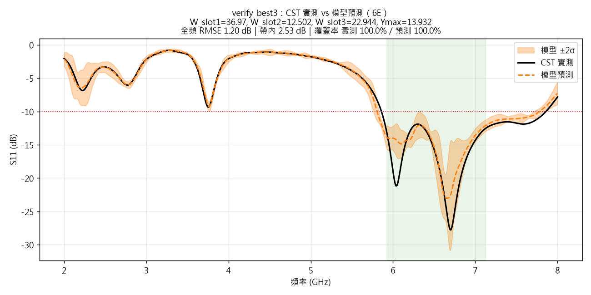

圖 3-3 最終設計 B 的 CST 實測與模型預測比對（重訓前）：全頻 RMSE 1.20 dB，覆蓋率實測與預測皆為 100%

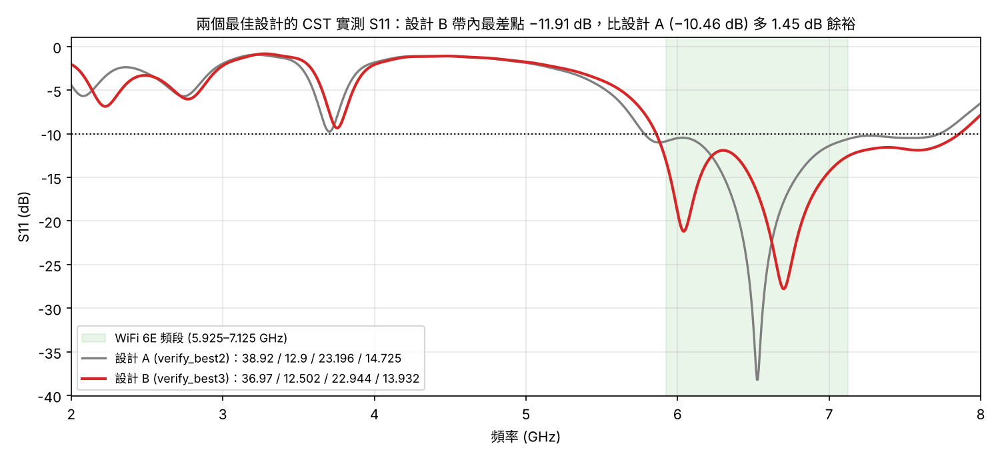

圖 3-4 設計 A 與設計 B 的 CST 實測 S11

設計 B 驗證後納入訓練（共 165 條）重新訓練，18 條留出驗證的平均誤差為 1.13 dB（內插基準 1.61 dB）。新模型學到了 6.04 GHz 附近的共振，前 5 名候選的預測邊界餘裕為 2.01–2.29 dB，只比設計 B 實測的 1.91 dB 多 0.1–0.4 dB，小於模型的不確定性（±0.39–0.82 dB）。這表示在目前的設計空間內已經收斂，設計 B 即為本專題的最終設計。之後再納入三個容差角落（168 條，3.1.4 節）重訓並定版，前 5 名預測邊界餘裕為 1.94–2.34 dB，設計 B 本身排第 5（預測 1.94 dB、實測 1.91 dB），結論不變。

#### 3.1.4 製程容差分析

設計 B 的四個尺寸同時偏差 ±0.3 mm 時，CST 實測仍維持 100% 覆蓋；±0.5 mm 是容差上限。實際製作 PCB 時，蝕刻與對位誤差會使槽孔與饋入線尺寸偏離設計值，因此本專題以 tolerance.py 評估設計 B 的容差。

**方法。** 以 CST 實測的設計 B 為名目點，對四個設計參數各自加入均勻分布 ±tol 的隨機誤差，做 Monte Carlo 抽樣。模型在名目點本身就有 1–2 dB 的誤差，因此估計時不直接用模型曲線，而是只借用模型的局部變化：

```latex
\hat{S}_{11}(p) = S_{11}^{CST}(p_0) + [\, f(p) - f(p_0) \,]
```

p₀ 為名目參數，f 為代理模型。絕對值以 CST 實測為準，模型只提供「參數變多少、S11 跟著變多少」。此分析只含四個設計參數的誤差，不含板厚、介電常數與銅厚。

**模型估計。** 結果如圖 3-5。單一參數敏感度以 W\_slot2 最大（−1.40 dB/mm，加寬變好），其次是 Ymax（+0.66 dB/mm，加大變差），W\_slot1 幾乎不影響（−0.12 dB/mm）。±0.05、0.1、0.2、0.3 mm 的良率（6E 覆蓋率維持 100% 的比例）都是 100%，帶內最差 S11 的 95 百分位分別為 −11.84、−11.76、−11.60、−11.39 dB（名目 −11.91 dB）。

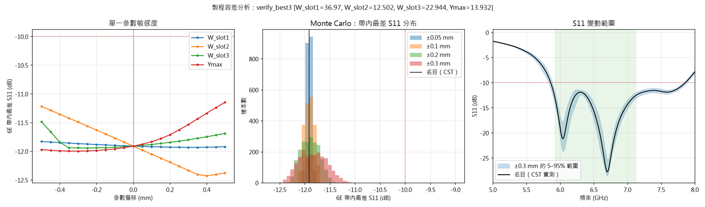

圖 3-5 設計 B 的製程容差分析：單一參數敏感度（左）、Monte Carlo 帶內最差 S11 分佈（中）、±0.3 mm 的 S11 變動範圍（右）

**CST 確認。** 為了確認估計可信，將估計的最差角落送回 CST（表 3-3、圖 3-6）。±0.3 mm 最差角落實測 −11.32 dB、仍 100% 覆蓋，比估計的 −10.98 dB 好 0.34 dB，估計偏保守。±0.5 mm 選了兩種失效方式不同的角落：(+0.5, −0.5, −0.5, +0.5) 實測 −10.28 dB、100% 覆蓋，與估計 −10.16 dB 接近；(−0.5, +0.5, −0.5, −0.5) 的 −10 dB 下緣漂到 5.948 GHz，越過 6E 下緣 5.925 GHz，覆蓋率降為 98.5%、帶內最差 −9.37 dB，估計的 −9.97 dB 偏樂觀 0.6 dB。把這 0.6 dB 當作懲罰重算均勻 ±0.5 mm 的 Monte Carlo，良率約 99.4%。

**表 3-3 容差最差角落的 CST 驗證**

| 情況 | W\_slot1 / W\_slot2 / W\_slot3 / Ymax (mm) | 容差估計最差 (dB) | CST 實測最差 (dB) | 6E 覆蓋率 | −10 dB 頻寬 (GHz) |
| --- | --- | --- | --- | --- | --- |
| 名目設計 B | 36.97 / 12.502 / 22.944 / 13.932 | — | −11.91 | 100% | 5.864–7.856 |
| ±0.3 mm (+, −, +, +) | 37.27 / 12.202 / 23.244 / 14.232 | −10.98 | −11.32 | 100% | 5.810–7.820 |
| ±0.5 mm (+, −, −, +) | 37.47 / 12.002 / 22.444 / 14.432 | −10.16 | −10.28 | 100% | 5.870–7.868 |
| ±0.5 mm (−, +, −, −) | 36.47 / 13.002 / 22.444 / 13.432 | −9.97 | −9.37 | 98.5% | 5.948–7.838 |

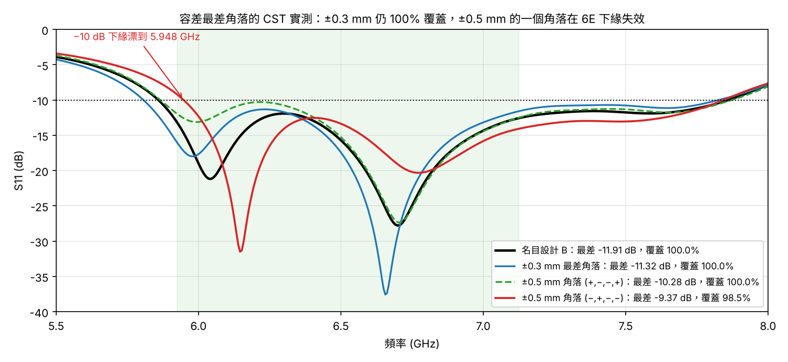

圖 3-6 容差最差角落的 CST 實測 S11：±0.3 mm 仍 100% 覆蓋，±0.5 mm 的一個角落在 6E 下緣失效

結論是設計 B 在 ±0.3 mm 內經 CST 確認可用，±0.5 mm 是容差上限，只有少數極端組合會掉出頻段。失效發生在 6E 下緣，而且這種「下緣漂移」正是模型估計偏樂觀的情況，若要提高容差，應優先在下緣保留餘裕。

三個角落納入訓練、模型定版後重跑容差分析，三個角落的估計與 CST 的差距都在 0.11 dB 以內（它們已是訓練點，不算獨立驗證）；±0.1、±0.3、±0.5 mm 的良率估計為 100%、100%、99.1%，Ymax 的敏感度由 +0.66 降為 +0.36 dB/mm，W\_slot2 仍最敏感（−1.39 dB/mm）。

#### 3.1.5 獨立測試集

模型在完全沒看過的 8 點上通過 6 點；失敗的 2 點都是 6E 下緣預測太樂觀。模型定版後，在設計 B 周圍約 ±1.5 mm 的範圍（W\_slot1 36.1–38.5、W\_slot2 11–14、W\_slot3 21.5–24.5、Ymax 12.5–15.5）以拉丁超立方取 8 點，用 CST 模擬後只用來測試。這個範圍涵蓋重訓後的前 5 名候選與容差角落，正是「模型在設計區夠不夠準」這個問題所在的區域。取點用隨機而不是最差角落，是為了估計模型的典型準確度。

**表 3-6 獨立測試集結果（定版模型，8 點皆未用於訓練或校正）**

| # | W\_slot1 / W\_slot2 / W\_slot3 / Ymax (mm) | 6E 覆蓋率 實測 / 預測 | −10 dB 下緣 實測 / 預測 (GHz) | 全頻 RMSE (dB) | 通過 |
| --- | --- | --- | --- | --- | --- |
| 1 | 36.2 / 11.5 / 23.9 / 13.5 | 83.5% / 96.5% | 6.488 / 6.374 | 1.26 | 否 |
| 2 | 36.4 / 13.4 / 24.4 / 13.7 | 100% / 100% | 5.762 / 5.726 | 1.00 | 是 |
| 3 | 36.9 / 13.2 / 22.0 / 15.1 | 79.0% / 78.5% | 6.182 / 6.188 | 0.52 | 是 |
| 4 | 37.1 / 11.0 / 22.4 / 15.2 | 64.5% / 63.5% | 6.374 / 6.368 | 0.27 | 是 |
| 5 | 37.6 / 12.0 / 22.8 / 12.5 | 95.5% / 97.5% | 5.984 / 5.960 | 1.80 | 是 |
| 6 | 37.6 / 12.6 / 23.7 / 14.7 | 100% / 100% | 5.732 / 5.720 | 0.44 | 是 |
| 7 | 38.1 / 12.2 / 21.7 / 14.2 | 90.0% / 95.5% | 6.278 / 5.984 | 0.24 | 否 |
| 8 | 38.2 / 13.7 / 23.1 / 13.0 | 100% / 100% | 5.906 / 5.894 | 1.35 | 是 |

通過率為 6/8（75%，Clopper-Pearson 95% 信賴區間 35–97% \[17\]），平均覆蓋率誤差 2.7 個百分點、平均 −10 dB 邊緣誤差 31 MHz，全頻 RMSE 平均 0.86 dB，比留出驗證的 1.20 dB 好，因為測試區就在資料最密的最佳區。

兩個未通過的點都錯在 6E 下緣，而且都是預測太樂觀。第 7 點的全頻 RMSE 只有 0.24 dB，但實測 S11 在 6.0–6.3 GHz 一路貼著 −10 dB，零點幾 dB 的誤差就讓下緣差了 294 MHz。8 點中有 6 點的下緣預測偏低，與 ±0.5 mm 容差角落的失效方式相同（3.1.4 節），表示模型在 6E 下緣附近有系統性的樂觀偏差，下緣是否過線必須以 CST 確認。

不確定性方面，−10 dB 附近的實際誤差中位數只有自報 σ 的 0.5 倍，信心區間在設計區偏寬約 2 倍，屬於保守。實測 100% 覆蓋的有 3 點，最好的第 8 點邊界餘裕仍不如設計 B，設計 B 維持為最終設計。測試集只有 8 點，通過率的信賴區間很寬，只能說明模型在設計區的典型表現。

### 3.2 結果分析

#### 3.2.1 外推區域的誤差：DOE 第 2 批重訓前測試

設計 A 驗證成功後，模型（139 條訓練）推薦了另一個預測更好的點 \[38.453, 13.049, 23.121, Ymax = 12.843\]，預測平均 −18.68 dB。當時在該區域做了第 2 批 DOE，並在重訓之前用舊模型預測這 25 組。結果顯示舊模型在這一區明顯誤判：

- 全頻 RMSE 平均 2.50 dB（中位數 1.86、最大 5.94），帶內 RMSE 平均 4.43 dB。
- 6E 覆蓋率誤差平均 13.6 個百分點，25 組中有 15 組超過 5 個百分點。
- Ymax < 13 的 8 組全部在 2.8–5.9 dB，覆蓋率常嚴重高估，例如 Ymax = 11.7 的一組實測 28%，預測卻是 97.5%；Ymax ≥ 14 的大多只有 0.3–1.3 dB（圖 3-7）。

原因是當時 Ymax < 14 的資料只有一條單參數掃描線，而且該線的其他參數（W\_slot2 = 9.5、W\_slot3 = 8）離最佳區很遠。模型在這一區是沿著單參數掃描線「外推」，並且偏向樂觀。推薦點 \[38.453, 13.049, 23.121, 12.843\] 恰好在這一區，因此作廢，沒有送去驗證。若當時直接信任模型、或先重訓再比對，就不會發現這個問題。

將 25 組納入訓練（共 164 條）後，留出驗證平均降至 1.09 dB（表 3-1），設計 A 的驗證誤差也從 2.26 dB 降到 0.97 dB，因為第 2 批恰好補到它周圍。

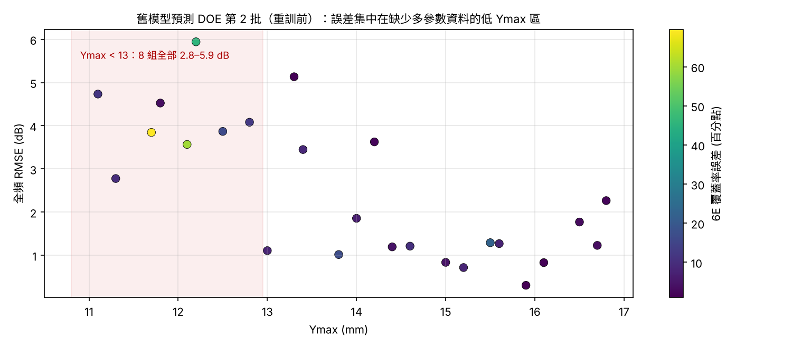

圖 3-7 舊模型對 DOE 第 2 批的預測誤差與 Ymax 的關係（重訓前，顏色為覆蓋率誤差）

#### 3.2.2 搜尋範圍與評分函數的修正

重訓後的模型在沒有限制搜尋範圍時，第 1 名變成 \[41.921, W\_slot2 = 7.634, 23.075, 12.386\]，預測覆蓋率 97.5%、平均 −22.97 dB，但不確定性 ±2.91 dB；第 2 名的 W\_slot2 = 7.499，不確定性 ±4.08 dB（圖 3-8）。W\_slot2 < 10 不在任何 DOE 範圍內，又是低 Ymax，與 3.2.1 節被推翻的情況相同。分析後發現兩個原因：

1. **搜尋範圍太寬**：信任區域以「所有 CST 樣本」為中心，包含單參數掃描線，模型可以沿掃描線外推到沒有多參數資料的區域。修正後預設只以 DOE 與 verify 點為中心，並限制在它們的參數範圍內（--search-scope doe）。
2. **評分函數可以拿深度換覆蓋率**：舊版分數為「覆蓋率 × 100 − 平均 dB」，1 個百分點的覆蓋率等於 1 dB 的平均深度，導致「97.5% + 平均 −23 dB」贏過「100% + −17 dB」。而深谷正是模型最容易預測過頭的地方（設計 A 預測 −56 dB、實測 −38 dB），等於獎勵模型的錯誤。修正後改為 2.8 節的「覆蓋率 → 邊界餘裕 → 封頂深度」。中間曾試過只用封頂深度當次要項，結果前 5 名全部擠到 DOE 邊界 W\_slot1 = 36.1，故改用邊界餘裕。

**表 3-4 評分函數修正前後的候選設計（同一個 164 條模型）**

| 設定 | 前 5 名預測 6E 覆蓋率 | 平均 S11 / 邊界餘裕 | 不確定性 | 前 5 名所在區域 |
| --- | --- | --- | --- | --- |
| 舊範圍 + 舊分數 | 第 1、2 名 97.5%–約 99% | 第 1 名 −22.97 dB | ±2.91–4.08 dB | W\_slot2 ≈ 7.5（DOE 範圍外） |
| DOE 範圍 + 舊分數 | 全部 100% | −16.3 至 −16.5 dB | ±0.36–0.92 dB | W\_slot2 13.3–13.8、W\_slot3 22.3–23.0、Ymax 13.8–15.9 |
| DOE 範圍 + 新分數 | 全部 100% | 邊界餘裕 1.9–2.1 dB | ±0.47–0.68 dB | W\_slot1 36.5–37.7、W\_slot2 12.5–13.1、W\_slot3 22.8–23.0、Ymax 13.2–14.5 |

兩項修正後，前 5 名集中在同一片區域且不貼著取樣邊界，而且改用舊的寬搜尋範圍也得到同一區，表示結果穩定。第 1 名就是設計 B，CST 實測邊界餘裕 1.91 dB，與預測的 2.05 dB 接近。

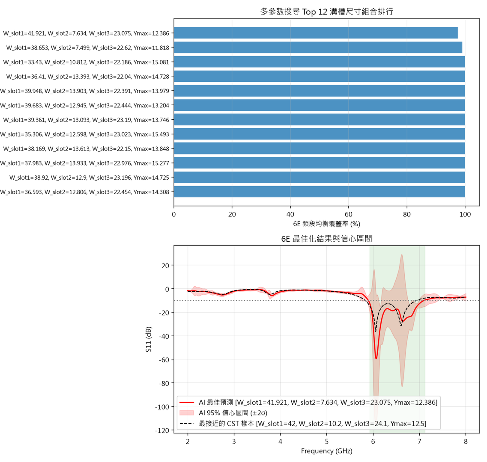

圖 3-8 修正前的最佳化結果（搜尋範圍未限制、舊評分函數）：第 1 名落在 W\_slot2 = 7.6，信心區間極寬

#### 3.2.3 不確定性校正的成效與限制

不確定性校正經過三個版本。第一版只有整體倍數 s，估得 1.84，最佳點不確定性從 ±0.69 放大到 ±1.26 dB。第二版加入距離項 β，並把留出驗證從 6 條增為 12 條，得到 s = 1.75、β = 0；第三版加入第 2 批 DOE 後（17 條驗證），s = 2.25、β = 0。校正後設計 A 的低估程度從 7.5 倍降到 1.5 倍。

β 一直是 0，代表誤差與「離最近樣本的歐氏距離」無關。例如設計 A 離最近樣本的正規化距離只有 0.068（W\_slot1 的正規化範圍 20–45 很寬，38.9 與 40 正規化後很近），誤差卻是當時最大的 2.26 dB；DOE 點距離 0.08–0.13，誤差 0.5–2 dB 不等。誤差大的真正原因是「那一區只有單參數掃描線、缺少多參數組合」，而單參數掃描線上的點會使歐氏距離看起來很近。

校正後仍然低估。DOE 第 2 批重訓前測試時，實際誤差約為自報 σ 的 2.2 倍；設計 B 的實際誤差為自報 σ 的 2.29 倍，只有 86.2% 的頻點落在 ±2σ 內（理想值約 95%）。因此在使用模型的信心區間時，實務上應再保守一倍左右；本專題也因此以「限制搜尋範圍」而非「相信信心區間」來避開外推區。

納入設計 B 重訓後（165 條資料、18 條留出驗證），s 再升至 2.55；再納入三個容差角落後（168 條、21 條留出）為 3.20，β 始終為 0。定版模型改為只用 −10 dB 附近的頻點校正（2.6 節），s = 3.10，與全頻校正幾乎相同，原因是設計 B 被平滑掉的 6.04 GHz 共振正好落在 −10 dB 附近。在獨立測試集上，−10 dB 附近的實際誤差中位數只有自報 σ 的 0.5 倍（3.1.5 節）。校正樣本包含最難預測的 DOE 角落，使 s 偏大；因此校正後的不確定性在稀疏區仍可能低估，在資料最密的設計區則偏保守約 2 倍。

#### 3.2.4 開發歷程

表 3-5 整理本專案以 Git 紀錄的主要里程碑。可以看到每一輪的改動都來自上一輪驗證暴露的問題。

**表 3-5 專案開發歷程**

| 事件 | 結果 |
| --- | --- |
| 整合組員的多個程式版本、建立 Git 專案與架構文件 | 以 V2 為主程式，修正無法執行的迭代訓練程式 |
| 改用槽孔天線的 4 個單參數掃描訓練 | 驗證 RMSE 0.05–0.51 dB；推薦點不確定性 ±3.7 dB |
| 第一個推薦點驗證（verify\_best）、補掃 Ymax 12.5–18 | 6E 覆蓋率只有 65.5% |
| DOE 第 1 批（25 組）、加入內插基準 | DOE 驗證點 0.32 dB，基準 0.68 dB |
| 設計 A 驗證 | 6E 100%，但 RMSE 2.26 dB、自報 ±0.30 dB |
| 新增 compare\_verify.py、不確定性校正、留出增為 12 條 | s = 1.75、β = 0；DOE 區真實誤差 0.5–2 dB |
| DOE 第 2 批（25 組），重訓前測試後重訓 | 重訓前 2.50 dB；重訓後留出 1.09 dB（基準 1.59） |
| 搜尋範圍限制在 DOE 區域 | 前 5 名全部預測 100% |
| 評分函數改為覆蓋率 → 邊界餘裕 → 封頂深度 | 第 1 名為設計 B |
| 設計 B 驗證 | 6E 100%、邊界餘裕 1.91 dB、RMSE 1.20 dB |
| 納入設計 B 重訓（165 條） | 18 條留出平均 1.13 dB（基準 1.61）；s = 2.55；前 5 名預測餘裕 2.01–2.29 dB，設計收斂 |
| 新增製程容差分析 tolerance.py | ±0.05–0.3 mm 良率 100%；W\_slot2、Ymax 最敏感 |
| CST 驗證 ±0.3 mm 最差角落 | 6E 100%、−11.32 dB |
| CST 驗證 ±0.5 mm 最差 2 角落 | 98.5%（−9.37 dB）與 100%（−10.28 dB）；容差上限約 ±0.5 mm |
| 納入容差角落重訓（168 條） | 21 條留出平均 1.20 dB（基準 1.66）；最佳化結果不變 |
| 定義設計用途準確度、改以 −10 dB 附近校正不確定性，模型定版 | 21 條留出中 18 條通過；s = 3.10 |
| 獨立測試集（8 點，定版後才模擬） | 6/8 通過（95% 信賴區間 35–97%）；失效皆在 6E 下緣且偏樂觀 |
| 以 50 Ω 正規化重跑設計 B | 6E 覆蓋率 0%（埠阻抗 100.6 Ω）；列為限制 |

#### 3.2.5 參考阻抗的限制

本專題所有 S11 都以饋入線的埠阻抗為參考；改以 50 Ω 正規化後，設計 B 在 6E 頻段的覆蓋率由 100% 降為 0%。CST 的波導埠預設以埠模態本身的阻抗計算 S 參數，本專題的求解器未勾選 Normalize to fixed impedance，而 CST 計算的埠線阻抗為 100.6 Ω（5 GHz）。整個資料蒐集、訓練與最佳化都在這個參考下進行，因此找到的是「對約 100 Ω 匹配」的設計。報告完成前以 50 Ω 正規化重跑設計 B，結果如表 3-7 與圖 3-9。

**表 3-7 設計 B 在兩種參考阻抗下的 S11 表現（同一組幾何參數，只有參考阻抗不同）**

| 參考阻抗 | 6E 覆蓋率 | 帶內最差點 (dB) | 帶內平均 (dB) | −10 dB 頻寬 (GHz) |
| --- | --- | --- | --- | --- |
| 埠阻抗（100.6 Ω，本報告其餘結果） | 100% | −11.91 | −17.02 | 5.864–7.856 |
| 50 Ω | 0% | −5.57 | −7.40 | 僅 3.764–3.836 |

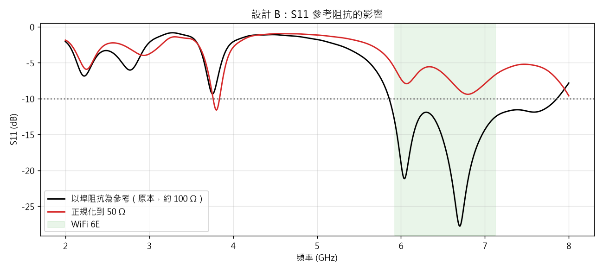

圖 3-9 設計 B 以埠阻抗（黑）與以 50 Ω（紅）為參考的 CST S11

在 50 Ω 參考下，6E 頻段內的 S11 只在 −5.6 至 −9.4 dB 之間，整段未過 −10 dB。單看阻抗差，100 Ω 的線直接接 50 Ω 的接頭，反射係數約 0.34（約 −9.5 dB），本身就已超過 −10 dB 的標準。

這個限制影響的是設計的可用性，不影響機器學習方法的結論：代理模型學的是 CST 在固定參考阻抗下的 S11，留出驗證、獨立測試與不確定性校正都在同一參考下成立；換成 50 Ω 參考，只需以新的參考重新取得訓練標籤，流程不變。另一個尚未釐清的問題是，依微帶線公式估算這條線的特性阻抗約為 74 Ω，與 CST 的 100.6 Ω 差距明顯，可能與波導埠的大小或位置有關（2.2 節）；需先確認埠設定，才能判斷 100.6 Ω 是線的真實阻抗還是設定造成的。

## 第四章 結論與未來方向

### 4.1 結論

本專題以機器學習代理模型輔助一個四參數槽孔天線的設計，以 176 次 CST 模擬（168 次用於訓練、其中 6 次為推薦點與容差驗證，8 次為獨立測試）找到完整涵蓋 WiFi 6E 頻段的設計。主要成果如下：

1. **設計目標達成。** 最終設計 B（W\_slot1 = 36.97、W\_slot2 = 12.502、W\_slot3 = 22.944、Ymax = 13.932 mm）經 CST 驗證，−10 dB 頻寬 5.864–7.856 GHz，6E 頻段覆蓋率 100%，帶內最差點 −11.91 dB（以約 100 Ω 的埠阻抗為參考，見 3.2.5 節）。單參數掃描中最好的組合只有 80%，兩批 DOE 中最好的為 97%。
2. **機器學習優於內插。** 21 條留出曲線的平均誤差為 1.20 dB，低於內插基準的 1.66 dB，21 條中 19 條優於基準；在單參數掃描上誤差只有 0.05–0.49 dB。
3. **模型適合篩選，不能取代驗證。** 以覆蓋率與 −10 dB 邊緣誤差衡量，留出驗證 21 條中 18 條通過，定版後的獨立測試集 8 點中 6 點通過；失效集中在 6E 下緣且預測偏樂觀，因此最終設計必須以 CST 確認。
4. **參考阻抗是主要限制。** 全部 S11 以 CST 計算的埠阻抗（100.6 Ω）為參考；改以 50 Ω 正規化後，設計 B 的 6E 覆蓋率由 100% 降為 0%。機器學習流程與參考阻抗無關，但最終設計須加上匹配才能用於 50 Ω 系統。
5. **評分函數決定設計品質。** 改為「先覆蓋率、再邊界餘裕」後，模型推薦的設計邊界餘裕從 0.46 dB 提高到 1.91 dB，對製程誤差更有抵抗力。
6. **重訓前測試可以揭露外推誤差。** 舊模型在缺少多參數資料的低 Ymax 區誤差達 2.8–5.9 dB，覆蓋率可高估到 70 個百分點。若未先測試就重訓，這個問題會被掩蓋，也會浪費一次對錯誤推薦點的驗證。限制搜尋範圍在多參數資料涵蓋區後，推薦結果變得穩定。
7. **自動化與可追蹤性。** LHS 取樣自動產生 CST 巨集，每批 25 組可無人值守跑完；比對紀錄與 Git 變更紀錄讓每一輪的誤差與決策都能回頭查證。
8. **製程容差充足。** 四個尺寸同時偏差 ±0.3 mm 的最差角落經 CST 實測仍 100% 覆蓋（−11.32 dB）；±0.5 mm 的兩個最差角落中有一個降至 98.5%（−9.37 dB），設計 B 的容差上限約為 ±0.5 mm。

整體而言，代理模型的價值不在於取代模擬器，而在於把有限的模擬次數集中在最有希望的區域；而每一個推薦仍必須經過模擬器驗證。

### 4.2 未來方向

1. **實作與量測。** 將設計 B 製作成實體天線，以向量網路分析儀量測 S11，並量測輻射場型與增益，確認模擬與實際的差異，並確認實際板材的板厚與介電常數誤差（未包含在 3.1.4 節的容差分析中）是否影響覆蓋率。
2. **擴大獨立測試集並修正下緣偏差。** 本專題已以「覆蓋率誤差 ≤ 5 個百分點、−10 dB 邊緣誤差 ≤ 100 MHz」定義模型是否夠準，但獨立測試集只有 8 點，通過率的信賴區間為 35–97%。可增加測試點，並針對 6E 下緣的樂觀偏差，加重下緣附近頻點的訓練權重。
3. **確認模擬可信度。** 以加密網格重跑設計 B，確認 CST 的數值誤差小於容差分析所比較的 0.3–0.6 dB 差異。
4. **改為 50 Ω 匹配。** 設計 B 在 50 Ω 參考下的 6E 覆蓋率為 0%（3.2.5 節）。應先確認波導埠設定，釐清 CST 的 100.6 Ω 與公式估算 74 Ω 的差異；之後有三種做法：(1) 若 CST 專案仍保留各次模擬的複數 S11，可匯出後在程式中換算為 50 Ω 參考，重新訓練與最佳化，不需重跑模擬；(2) 將饋入線放寬至約 3 mm 或加入阻抗轉換段，以 50 Ω 正規化重新取樣；(3) 將饋入線寬度納入設計變數。三者都可沿用本專題的代理模型流程。
5. **改善不確定性模型。** 距離項始終無效，可改用「離最近 DOE 樣本的距離」，或試驗 MC dropout、以不同資料子集訓練的集成，讓信心區間更接近實際誤差。
6. **模型調整。** 目前超參數皆為手動設定，防過擬合只有 weight decay。可嘗試交叉驗證、early stopping 與較小的網路。
7. **擴充資料與頻段。** 前 5 名候選中有貼在 DOE 下界 W\_slot1 = 36.1 的點（例如 \[36.1, 13.214, 22.997, 14.655\]），顯示更小的 W\_slot1 可能還有空間，可往該方向補一批 DOE；但預測的改善小於模型不確定性。程式已支援 WiFi 7 三頻段（2.4 / 5 / 6 GHz）的評分，可進一步嘗試同時涵蓋三個頻段的設計。
8. **擴大容差餘裕。** ±0.5 mm 的失效發生在 6E 下緣（−10 dB 下緣往高頻漂到 5.948 GHz）。若需要更大容差，可在評分中加入「−10 dB 下緣離 5.925 GHz 的距離」，或對候選點直接計算最差角落再挑選；容差分析也可加入板厚與介電常數的誤差。

## 參考文獻

1. C. A. Balanis, *Antenna Theory: Analysis and Design*, 4th ed. Hoboken, NJ, USA: Wiley, 2016.
2. Federal Communications Commission, “Unlicensed Use of the 6 GHz Band,” Report and Order, FCC 20-51, Apr. 2020.
3. S. Koziel and S. Ogurtsov, *Antenna Design by Simulation-Driven Optimization*. Cham, Switzerland: Springer, 2014.
4. M. Tancik *et al.*, “Fourier features let networks learn high frequency functions in low dimensional domains,” in *Proc. NeurIPS*, 2020.
5. B. Lakshminarayanan, A. Pritzel, and C. Blundell, “Simple and scalable predictive uncertainty estimation using deep ensembles,” in *Proc. NeurIPS*, 2017.
6. M. D. McKay, R. J. Beckman, and W. J. Conover, “A comparison of three methods for selecting values of input variables in the analysis of output from a computer code,” *Technometrics*, vol. 21, no. 2, pp. 239–245, 1979.
7. N. Srinivas, A. Krause, S. M. Kakade, and M. Seeger, “Gaussian process optimization in the bandit setting: No regret and experimental design,” in *Proc. ICML*, 2010.
8. I. Loshchilov and F. Hutter, “Decoupled weight decay regularization,” in *Proc. ICLR*, 2019.
9. I. Loshchilov and F. Hutter, “SGDR: Stochastic gradient descent with warm restarts,” in *Proc. ICLR*, 2017.
10. A. Paszke *et al.*, “PyTorch: An imperative style, high-performance deep learning library,” in *Proc. NeurIPS*, 2019.
11. Dassault Systèmes, *CST Studio Suite*, electromagnetic field simulation software.
12. *IEEE Standard for Information Technology—Part 11: Wireless LAN MAC and PHY Specifications, Amendment 1: Enhancements for High-Efficiency WLAN*, IEEE Std 802.11ax-2021.
13. S. Elfwing, E. Uchibe, and K. Doya, “Sigmoid-weighted linear units for neural network function approximation in reinforcement learning,” *Neural Networks*, vol. 107, pp. 3–11, 2018.
14. V. Kuleshov, N. Fenner, and S. Ermon, “Accurate uncertainties for deep learning using calibrated regression,” in *Proc. ICML*, 2018.
15. D. M. Pozar, *Microwave Engineering*, 4th ed. Hoboken, NJ, USA: Wiley, 2012.
16. Danner Dan, CST 微帶線波導埠擴展係數之計算與設定（技術文章）, CSDN. \[Online\]. Available: https://damodev.csdn.net/6a438f68662f9a54cb86f652.html（2026 年 11 月 20 日擷取）
17. C. J. Clopper and E. S. Pearson, “The use of confidence or fiducial limits illustrated in the case of the binomial,” Biometrika, vol. 26, no. 4, pp. 404–413, 1934.

## 著作權授權書

本授權書所授權之專題報告為學生 楊閔翔、【組員姓名】 在中原大學 115 學年度第一學期所撰寫。

專題名稱：機器學習輔助天線設計：具不確定性估計之神經網路代理模型——以 WiFi 6E 微帶線耦合饋入平行三槽孔寬頻天線為例

1. 本人具有著作財產權之專題全文，同意授予中原大學電機系，得重製成電子資料檔後收錄於該單位之網路，並與台灣學術網路及科技網路連線，得不限地域時間與次數以光碟或紙本重製發行。如有因涉及專利等智慧財產權之申請，請將本專題全文延至民國　　年　　月　　日後再公開。
2. 本人具有著作財產權之專題內容文字與實驗數據，係本人所原創、實驗所得，如涉有智慧財產權等相關爭議與法律責任，概由本人承擔。

學生簽名：（所有同學親筆正楷）

指導老師：

中 華 民 國　　年　　月　　日
